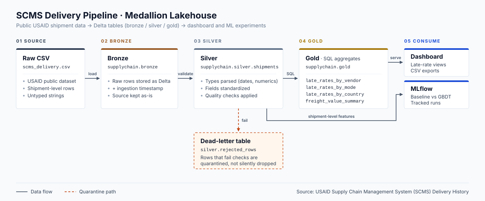

# Shipment delay lakehouse

I built this project to answer three straightforward questions about international health commodity supply chains: which shipments arrive late, what traits do those late shipments share, and how much does freight cost relative to the value of the goods? Out of 10,319 valid deliveries in the dataset, 1,186 arrived past their scheduled delivery date (11.5%). Ocean shipments had the highest late delivery rate at 17.5%, followed closely by road freight at 16.1%, whereas air freight was late only 9.6% of the time. However, air transport cost an average of 8.1% to 9.0% of the commodity value shipped, while ocean and road freight cost only 3.2% to 3.4%. Delivery delays were highest on routes to Cote d'Ivoire (12.4%) and Uganda (12.6%), while shipments to Vietnam arrived on time 99.1% of the time.

## Architecture

The bronze notebook loads the raw CSV as-is into Delta format at `supply_chain.bronze.shipments_raw`. It adds an ingestion timestamp and source file path without dropping unparseable text fields or casting string types.

The silver notebook renames all columns to snake_case, parses dates, casts numeric values to double, and standardizes vendor names and country spellings. It runs six data quality checks, routes five invalid records to `supply_chain.silver.rejected_rows`, and writes 10,319 verified records to `supply_chain.silver.shipments`.

The gold notebook uses Spark SQL to build four small aggregation tables in `supply_chain.gold`: late delivery rates and average delays by vendor, by shipment mode, and by destination country, plus freight spend as a share of line value by commodity group and mode.

The consumption layer exports the gold aggregates to CSV for a two-page Power BI dashboard and trains an MLflow-tracked machine learning model on pre-shipment features to predict delay risk.

## How to run it

1. Clone this repository to your local machine and verify repository hygiene by running `python scripts/check_repo.py`.
2. Download `SCMS_Delivery_History_Dataset.csv` from Kaggle (or the USAID open data catalog) and place it into the `data/` folder.
3. In your Databricks workspace, create the `supply_chain` catalog and upload the CSV to a Unity Catalog Volume at `/Volumes/supply_chain/bronze/raw_data/SCMS_Delivery_History_Dataset.csv`.
4. Import the four notebooks in `notebooks/` into your Databricks workspace as source files.
5. Create a Databricks Workflow containing four tasks linked in sequence: `01_bronze` -> `02_silver` -> `03_gold` -> `04_model`.
6. Run the workflow manually. Open Catalog Explorer, navigate to `supply_chain.gold.late_rates_by_mode`, and click the Lineage tab to inspect the full data lineage from source to gold.

## Data quality

| Check | Rule | Failed rows | Action taken |
|---|---|---|---|
| 1. Primary key nulls | ID cannot be null | 0 | Verified passing |
| 2. Deduplication | No duplicate shipment lines | 0 | Verified passing |
| 3. Date chronology | Delivered date must not precede PO sent date | 5 | Routed to `supply_chain.silver.rejected_rows` with reason |
| 4. Value boundaries | Quantity and line value must be non-negative | 0 | Verified passing |
| 5. Missing spend tracking | Report share of nulls in weight (38.3%) and freight (40.0%) | 0 dropped | Preserved in silver; logged in notebook output |
| 6. Privacy check | Schema must contain no personal data names | 0 | Verified passing via automated column assertion |

## Model

I trained a baseline logistic regression model and a gradient boosting classifier (HistGradientBoosting) on 8,255 training records and evaluated both on 2,064 holdout test records using a stratified split. Both models used only information known before shipment dispatch: vendor, country, shipment mode, product group, quantity, line value, weight, and planned lead time.

| Model | Precision | Recall | F1 Score | ROC AUC |
|---|---|---|---|---|
| Baseline (Logistic Regression) | 0.1953 | 0.8354 | 0.3165 | 0.7468 |
| Final (HistGradientBoosting) | 0.2608 | 0.6878 | 0.3782 | 0.7935 |

The gradient boosting model improved ROC AUC to 0.7935 and lifted precision by 6.5 percentage points over the baseline while maintaining a strong recall of 68.8%. The most predictive signals were historical vendor reliability, destination country, and shipment mode.

Model limitation: This model flags shipments that match historical risk patterns (such as specific high-delay vendors or ocean freight lanes), but it cannot predict unpredictable operational shocks like port strikes, customs policy changes, or extreme weather events.

## What went wrong or surprised me

1. Over 39% of freight cost entries were text strings instead of numbers: Many rows had values like "Freight Included in Commodity Cost" or "See ASN-32231". If I had converted them naively or dropped missing rows, I would have discarded nearly 40% of the dataset. I converted those strings to nulls so the delivery records remained available for delay analysis.
2. Five shipments arrived before their purchase order was sent: The delivered date preceded the PO sent date by several weeks or months. Rather than deleting them silently, I built a dead-letter table (`supply_chain.silver.rejected_rows`) with a clear error reason so data auditors can review contract anomalies.
3. Ocean freight had almost double the failure rate of air freight: I expected ground transport to be the slowest mode, but ocean shipments had the highest proportion of late arrivals (17.5% late, averaging +5.9 days delay), whereas air shipments arrived on time in over 90% of deliveries.

## Data and privacy

This project uses the public SCMS Delivery History dataset published by USAID, which tracks international shipments of antiretroviral medications, test kits, and laboratory supplies. The dataset contains no personal data: no individual patient records, personal email addresses, phone numbers, or residential addresses are present.

To protect project hygiene, the raw CSV is excluded from version control via `.gitignore`, credentials are read from environment variables using `.env.example` placeholders, and notebooks are saved as Databricks source `.py` files without embedded execution outputs. The repository check script (`scripts/check_repo.py`) runs before commits to verify that no files exceed 5 MB and that no secrets, email patterns, or workspace URLs are tracked in git.

## What I would do next

1. Ingestion triggers: Replace manual volume uploads with cloud storage event notifications so new CSV drops trigger bronze notebook runs automatically.
2. Declarative contracts: Convert the custom PySpark quality checks into Delta Live Tables expectations to stop bad records at ingestion time without manual filtering logic.
3. Cost optimization: Train a secondary regression model to predict freight cost for shipments where freight was bundled into the commodity price.

---
Built by `Adarsh`
